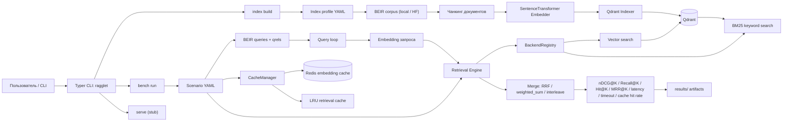

# Ragglet

**Ragglet** — исследовательский стенд для воспроизводимого бенчмаркинга retrieval-части в системах класса RAG (Retrieval-Augmented Generation). Проект ориентирован на учебно-научную работу: позволяет собирать индекс по корпусу документов, запускать сценарии экспериментов и сравнивать качество поиска по фиксированному набору запросов.

## Назначение проекта

Проект предназначен для проверки того, как параметры индексации, стратегия поиска и кэширование влияют на:

- качество извлечения релевантных фрагментов;
- задержки на этапах embedding и retrieval;
- устойчивость сценария при серийных прогонах.

В текущей версии основной акцент сделан именно на **retrieval benchmark**, а не на полной генеративной RAG-цепочке.

## Что реализовано

- поддержка готовых датасетов в индустриальном формате **BEIR** (локально или с HuggingFace Hub);
- офлайн-индексация корпуса в Qdrant;
- разбиение документов на чанки (или индексация документов целиком, `chunking.method: none`) и построение эмбеддингов через `sentence-transformers`;
- запуск экспериментальных сценариев из YAML-конфигураций;
- поддержка single-source retrieval и fanout/hybrid retrieval;
- подсчет метрик `nDCG@K`, `Recall@K`, `R_cap@K`, `Hit@K`, `MRR@K` на уровне документов (опционально `MRR@K`, `Precision@K` на уровне чанков), latency и cache hit rate; что значит каждая метрика — [docs/metrics.md](docs/metrics.md);
- сохранение покомпонентных и агрегированных результатов в `results/`.

## Формат датасета (BEIR)

Канонический формат — [BEIR](https://github.com/beir-cellar/beir): так раздаются MS MARCO,
NQ, HotpotQA, SciFact, FiQA, TREC-COVID и другие. Один формат — один адаптер. Датасет это
директория (или HF-репозиторий) из трёх частей:

```text
<dataset>/
  corpus.jsonl      {"_id": "d12", "title": "...", "text": "..."}
  queries.jsonl     {"_id": "q3",  "text": "..."}
  qrels/<split>.tsv query-id <TAB> corpus-id <TAB> score   # TREC-style, с заголовком
```

Ground truth (`qrels`) ссылается на **id документа** (`corpus._id`), поэтому метрики
считаются на document-level: retrieved-чанки проецируются в свой `doc_id` с дедупом.

Структура проекта:

- `datasets/demo/` — демо-датасет в формате BEIR;
- `configs/indexes/*.yaml` — профили построения индекса;
- `configs/scenarios/*.yaml` — сценарии экспериментальных прогонов.

Свой корпус из `.md`/`.txt` можно сконвертировать в BEIR:

```bash
uv run ragglet dataset import <corpus_dir> <out_dir> --queries <legacy.jsonl> --split test
```

## Как запустить

### 1. Подготовить окружение

Нужны:

- Python 3.12+;
- `uv`;
- Docker с Docker Compose.

Установить Python-зависимости:

```bash
uv sync
```

Если зависимости уже установлены в локальный `.venv`, можно запускать команды через `.venv/bin/ragglet`, но основной путь для проекта — `uv run ...`.

### 2. Поднять Qdrant и Redis

Для базового vector-only benchmark нужен Qdrant. Redis нужен для сценариев с кэшем, но его удобно поднимать сразу:

```bash
docker compose -f docker/docker-compose.yaml --profile qdrant up -d qdrant redis
```

Проверить, что контейнеры запущены:

```bash
docker compose -f docker/docker-compose.yaml ps
```

По умолчанию используются:

- Qdrant: `http://localhost:6333`;
- Redis: `redis://localhost:6379/0`.

### 3. Собрать индекс

Индекс строится по профилю `configs/indexes/demo.yaml` из BEIR-корпуса `datasets/demo/` в Qdrant collection `chunks_v1`:

```bash
uv run ragglet index build configs/indexes/demo.yaml
```

Датасет в профиле задаётся блоком `dataset: {source: local|hf, id: ...}`. Для готового
датасета с HuggingFace Hub достаточно указать `source: hf` и `id` репозитория (например
`BeIR/scifact`) — файлы BEIR скачаются в кэш автоматически.

Перед эмбеддингом `index build` проверяет весь датасет (corpus, queries, все split qrels):
повторы `_id`, qrels на несуществующие документы и запросы, битые строки, пустые
релевантные документы. Нарушения печатаются все сразу, с файлом и строкой; есть ошибка —
индекс не собирается.

Метаданные индекса (хэш корпуса, ревизия модели эмбеддингов, chunking, storage layout)
записываются в Qdrant collection **после** последнего upsert: коллекция без них считается
недособранной.

### 4. Запустить benchmark

Перед прогоном `bench run` делает preflight: валидирует датасет сценария и проверяет, что
индекс собран полностью, из того же корпуса (по хэшу содержимого), с той же моделью
эмбеддингов и в том же storage layout. При любом расхождении прогон не начинается и
каталог результатов не создаётся. Модель эмбеддингов загружается ровно той ревизии, которой
собран индекс.

Тот же preflight без прогона запросов:

```bash
uv run ragglet bench validate configs/scenarios/baseline_qdrant.yaml
```

Базовый сценарий: один vector source, без кэша.

```bash
uv run ragglet bench run configs/scenarios/baseline_qdrant.yaml
```

Hybrid/fanout сценарий: Qdrant vector + in-memory BM25, Redis embedding cache и memory LRU retrieval cache.

```bash
uv run ragglet bench run configs/scenarios/baseline_qdrant_fanout_two_vec.yaml
```

Для fanout-сценария Redis должен быть доступен, потому что `cache.enabled: true` включает Redis embedding cache.

### 5. Посмотреть результаты

Каждый запуск создает отдельную папку:

```text
results/runs/<scenario_name>_<utc_timestamp>/
```

Типичные файлы:

- `scenario.snapshot.json` и `scenario.snapshot.yaml` — нормализованный снимок scenario;
- `manifest.json` — что и где измеряли:
  - `dataset` — ревизия датасета, хэши корпуса и eval-набора;
  - `index` — сборка индекса: profile, время, ревизия модели, chunking, фактические параметры коллекции (`params`) и окружение сборки (`build_env`);
  - `rerank` — ревизия rerank-модели (`null`, если rerank выключен);
  - `env` — окружение прогона: commit ragglet, Python, машина (`system`), устройство эмбеддингов (`compute`), версии и состояние сервисов (`services`: storage, cache);
- `per_query.repeat0.csv` / `.parquet` — результаты по каждому запросу, если `run.save_per_query: true`;
- `summary.csv` и `summary.json` — сводка по каждому repeat;
- `summary.aggregate.csv` и `summary.aggregate.json` — агрегация по repeats.

Формат per-query файлов задается через `output.format: csv | parquet | both`. Summary-файлы сейчас всегда пишутся в CSV и JSON.

Quality-метрики двух прогонов сравнимы, если в `manifest.json` у них равны `dataset.corpus_sha256` и `dataset.eval_sha256`. Различия индекса (chunking, модель) — экспериментальный фактор и видны в секции `index`.

`ragglet.bench.compare.compare_runs(a, b)` сравнивает два каталога прогонов и относит каждое различие к одному из классов:

- `data` (`dataset`) — quality-метрики несравнимы;
- `config` (snapshot сценария, `index`, `rerank`) — настройка RAG, то, что исследуем;
- `env` (`env`, `index.build_env`) — окружение: часть разницы метрик может быть его эффектом; различия `system`, `compute` и `services` делают latency несравнимой.

Разница метрик — эффект настройки RAG, если различий `data` и `env` нет. Зависимости фиксирует `uv.lock` того коммита, что записан в `env.commit`.

## Конфиги

Подробный справочник по доступным параметрам, реальной поддержке и конфликтам находится в:

```text
docs/config-reference.yaml
```

Основные файлы:

- `configs/indexes/demo.yaml` — профиль индексации;
- `configs/scenarios/baseline_qdrant.yaml` — baseline vector retrieval;
- `configs/scenarios/baseline_qdrant_fanout_two_vec.yaml` — fanout/hybrid retrieval с кэшем.

Ключевые правила:

- `chunk_overlap` должен быть меньше `chunk_size`; иначе профиль не пройдет валидацию;
- `chunking.method: none` индексирует документ целиком (как в BEIR); `chunk_size`/`chunk_overlap` с ним запрещены;
- `qrels` ссылается на `corpus._id` (document-level); при индексации chunk получает `doc_id` и внутренний `chunk_id`;
- `metrics.quality` задает `k` и метрики уровней: `doc` (по умолчанию `ndcg`, `recall`, `hit`, `mrr`) и `chunk` (по умолчанию выключен; включайте, если сценарий варьирует chunking или context). `recall@k` — доля найденных релевантных документов, `hit@k` — найден ли хотя бы один, `ndcg@k` — качество порядка с учётом оценок qrels; подробно в [docs/metrics.md](docs/metrics.md). Каждое `k` не должно превышать глубину финального списка (`retrieval.top_k`, при rerank — `output_top_n`);
- `storage.backend.type` реально поддерживает только `qdrant`;
- `rerank` поддерживает локальный `cross_encoder` provider из `sentence-transformers`;
- `context` поддерживает сбор retrieved/reranked чанков по политикам `top_n`, `threshold` и `adaptive`;
- `generation` поддерживает `noop` и `openai_compatible`; при `enabled: true` question/context могут быть отправлены во внешний provider;
- `run.load` задает, когда запускать запросы. Модель `closed` держит `concurrency` запросов одновременно в работе, от эмбеддинга до ответа LLM (по умолчанию 1). Сетевые этапы идут конкурентно, а локальные модели на CPU (эмбеддинг, BM25, rerank) обрабатывают один вызов за раз, и ожидание своей очереди видно в `lat_*_ms`. Своя схема подачи запросов — класс в `src/ragglet/bench/load.py` и строка в `LOAD_MODELS`. При `concurrency > 1` доля попаданий кэша в строке зависит от порядка завершения запросов.

## Полезные команды

Показать CLI help:

```bash
uv run ragglet --help
uv run ragglet index --help
uv run ragglet bench --help
uv run ragglet bench validate configs/scenarios/baseline_qdrant.yaml
```

Остановить сервисы:

```bash
docker compose -f docker/docker-compose.yaml --profile qdrant down
```

Остановить сервисы и удалить volume с данными:

```bash
docker compose -f docker/docker-compose.yaml --profile qdrant down -v
```

## Частые проблемы

Если `bench run` пишет `Index is not compatible with scenario` — индекс собран из другого корпуса (например, после правки `corpus.jsonl`), другой моделью, в другом storage layout или сборка не завершилась. Пересоберите индекс: `ragglet index build <index_profile.yaml>`.

Чтобы зафиксировать версию HF-датасета или модели, скопируйте ревизию из `manifest.json` в конфиг: `dataset.revision` (сценарий и index profile), `embedding.revision` (index profile) и `rerank.revision` (сценарий). У local-датасета ревизии нет: его версия — хэш содержимого.

Предупреждение `index.not_green` означает, что Qdrant ещё оптимизирует коллекцию (обычно сразу после `index build`): latency и recall такого прогона нерепрезентативны. Дождитесь статуса `green` и запустите заново.

Если индекс строится слишком долго или создается неожиданно много чанков, проверьте `chunk_size` и `chunk_overlap` в index profile. Схема уже запрещает `chunk_overlap >= chunk_size`, но слишком маленький `chunk_size` все равно может сделать эксперимент нерепрезентативным.

Если fanout-сценарий падает на кэше, проверьте, что Redis запущен и доступен по endpoint из scenario.

Если `docker compose --profile app` не собирается, это ожидаемо для текущего состояния: app container profile зарезервирован, а рабочий путь запуска сейчас — локальный CLI через `uv run` плюс Qdrant/Redis из compose.

## Научная ценность

Ragglet можно использовать как компактную экспериментальную платформу для:

- сравнения стратегий поиска в RAG;
- анализа компромисса между качеством и временем отклика;
- подготовки воспроизводимых вычислительных экспериментов для НИР, ВКР и конференционных докладов.

## Ограничения текущей версии

- основной поддерживаемый backend для экспериментов — `Qdrant`;
- генерация ответа LLM и сервисный API пока не являются завершенными модулями;
- проект ориентирован на исследование retrieval-контура, а не на промышленный production-ready пайплайн.

## Архитектура


