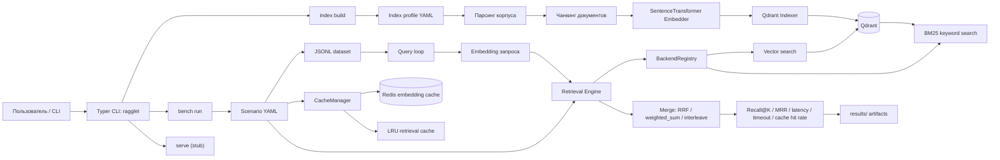

# Ragglet

**Ragglet** — исследовательский стенд для воспроизводимого бенчмаркинга retrieval-части в системах класса RAG (Retrieval-Augmented Generation). Проект ориентирован на учебно-научную работу: позволяет собирать индекс по корпусу документов, запускать сценарии экспериментов и сравнивать качество поиска по фиксированному набору запросов.

## Назначение проекта

Проект предназначен для проверки того, как параметры индексации, стратегия поиска и кэширование влияют на:

- качество извлечения релевантных фрагментов;
- задержки на этапах embedding и retrieval;
- устойчивость сценария при серийных прогонах.

В текущей версии основной акцент сделан именно на **retrieval benchmark**, а не на полной генеративной RAG-цепочке.

## Что реализовано

- офлайн-индексация текстового корпуса в Qdrant;
- разбиение документов на чанки и построение эмбеддингов через `sentence-transformers`;
- запуск экспериментальных сценариев из YAML-конфигураций;
- поддержка single-source retrieval и fanout/hybrid retrieval;
- подсчет метрик `Recall@K`, `MRR@K`, latency и cache hit rate;
- сохранение покомпонентных и агрегированных результатов в `results/`.

## Структура входных данных

- `datasets/demo/corpus/` — текстовый корпус для индексации;
- `data/queries/*.jsonl` — набор запросов и ground truth;
- `configs/indexes/*.yaml` — профили построения индекса;
- `configs/scenarios/*.yaml` — сценарии экспериментальных прогонов.

Пример строки в наборе запросов:

```json
{"id":"q001","question":"What is RAG?","relevant":["rag_overview_definition_and_pipeline.md#0"]}
```

## Быстрый запуск

```bash
uv sync
docker compose -f docker/docker-compose.yaml --profile qdrant up -d qdrant redis
uv run ragglet index build configs/indexes/demo.yaml
uv run ragglet bench run configs/scenarios/baseline_qdrant.yaml
```

После выполнения эксперимента артефакты сохраняются в каталоге `results/runs/`: покомпонентные таблицы по запросам, сводки по повторам и агрегированные метрики.

## Научная ценность

Ragglet можно использовать как компактную экспериментальную платформу для:

- сравнения стратегий поиска в RAG;
- анализа компромисса между качеством и временем отклика;
- подготовки воспроизводимых вычислительных экспериментов для НИР, ВКР и конференционных докладов.

## Ограничения текущей версии

- основной поддерживаемый backend для экспериментов — `Qdrant`;
- генерация ответа LLM и сервисный API пока не являются завершенными модулями;
- проект ориентирован на исследование retrieval-контура, а не на промышленный production-ready пайплайн.

## Архитектура

