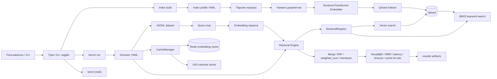

# Ragglet

**Ragglet** — исследовательский стенд для воспроизводимого бенчмаркинга retrieval-части в системах класса RAG (Retrieval-Augmented Generation). Проект ориентирован на учебно-научную работу: позволяет собирать индекс по корпусу документов, запускать сценарии экспериментов и сравнивать качество поиска по фиксированному набору запросов.

## Назначение проекта

Проект предназначен для проверки того, как параметры индексации, стратегия поиска и кэширование влияют на:

- качество извлечения релевантных фрагментов;
- задержки на этапах embedding и retrieval;
- устойчивость сценария при серийных прогонах.

В текущей версии основной акцент сделан именно на **retrieval benchmark**, а не на полной генеративной RAG-цепочке.

## Что реализовано

- офлайн-индексация текстового корпуса в Qdrant;
- разбиение документов на чанки и построение эмбеддингов через `sentence-transformers`;
- запуск экспериментальных сценариев из YAML-конфигураций;
- поддержка single-source retrieval и fanout/hybrid retrieval;
- подсчет метрик `Recall@K`, `MRR@K`, latency и cache hit rate;
- сохранение покомпонентных и агрегированных результатов в `results/`.

## Структура входных данных

- `datasets/demo/corpus/` — текстовый корпус для индексации;
- `data/queries/*.jsonl` — набор запросов и ground truth;
- `configs/indexes/*.yaml` — профили построения индекса;
- `configs/scenarios/*.yaml` — сценарии экспериментальных прогонов.

Пример строки в наборе запросов:

```json
{"id":"q003","question":"What are common failure modes in RAG systems?","relevant":["rag_retrieval_vs_generation_failure_modes.md#0"]}
```

## Как запустить

### 1. Подготовить окружение

Нужны:

- Python 3.12+;
- `uv`;
- Docker с Docker Compose.

Установить Python-зависимости:

```bash
uv sync
```

Если зависимости уже установлены в локальный `.venv`, можно запускать команды через `.venv/bin/ragglet`, но основной путь для проекта — `uv run ...`.

### 2. Поднять Qdrant и Redis

Для базового vector-only benchmark нужен Qdrant. Redis нужен для сценариев с кэшем, но его удобно поднимать сразу:

```bash
docker compose -f docker/docker-compose.yaml --profile qdrant up -d qdrant redis
```

Проверить, что контейнеры запущены:

```bash
docker compose -f docker/docker-compose.yaml ps
```

По умолчанию используются:

- Qdrant: `http://localhost:6333`;
- Redis: `redis://localhost:6379/0`.

### 3. Собрать индекс

Индекс строится по профилю `configs/indexes/demo.yaml` из корпуса `datasets/demo/corpus/` в Qdrant collection `chunks_v1`:

```bash
uv run ragglet index build configs/indexes/demo.yaml
```

Важно: `embedding.model` и `embedding.normalize` в index profile должны совпадать с настройками scenario, которым потом запускается benchmark. `index build` сохраняет эти параметры в metadata Qdrant collection, а `bench run` проверяет их перед запуском и падает с понятной ошибкой при несовпадении.

### 4. Запустить benchmark

Перед запуском эксперимента можно проверить, что `relevant[]` из dataset действительно существуют в payload уже собранного индекса:

```bash
uv run ragglet bench validate configs/scenarios/baseline_qdrant.yaml
```

Команда делает легкий preflight: читает JSONL, забирает из Qdrant только payload-поле `external_id` и сравнивает строки. Embeddings и retrieval при этом не запускаются.

Базовый сценарий: один vector source, без кэша.

```bash
uv run ragglet bench run configs/scenarios/baseline_qdrant.yaml
```

Hybrid/fanout сценарий: Qdrant vector + in-memory BM25, Redis embedding cache и memory LRU retrieval cache.

```bash
uv run ragglet bench run configs/scenarios/baseline_qdrant_fanout_two_vec.yaml
```

Для fanout-сценария Redis должен быть доступен, потому что `cache.enabled: true` включает Redis embedding cache.

### 5. Посмотреть результаты

Каждый запуск создает отдельную папку:

```text
results/runs/<scenario_name>_<utc_timestamp>/
```

Типичные файлы:

- `scenario.snapshot.json` и `scenario.snapshot.yaml` — нормализованный снимок scenario;
- `per_query.repeat0.csv` / `.parquet` — результаты по каждому запросу, если `run.save_per_query: true`;
- `summary.csv` и `summary.json` — сводка по каждому repeat;
- `summary.aggregate.csv` и `summary.aggregate.json` — агрегация по repeats.

Формат per-query файлов задается через `output.format: csv | parquet | both`. Summary-файлы сейчас всегда пишутся в CSV и JSON.

## Конфиги

Подробный справочник по доступным параметрам, реальной поддержке и конфликтам находится в:

```text
docs/config-reference.yaml
```

Основные файлы:

- `configs/indexes/demo.yaml` — профиль индексации;
- `configs/scenarios/baseline_qdrant.yaml` — baseline vector retrieval;
- `configs/scenarios/baseline_qdrant_fanout_two_vec.yaml` — fanout/hybrid retrieval с кэшем.

Ключевые правила:

- `chunk_overlap` должен быть меньше `chunk_size`; иначе профиль не пройдет валидацию;
- `data/queries/*.jsonl[].relevant` должен ссылаться на `external_id` чанков в формате `<relative_doc_path>#<chunk_index>`;
- `storage.backend.type` реально поддерживает только `qdrant`;
- `rerank` поддерживает локальный `cross_encoder` provider из `sentence-transformers`;
- `generation` пока является reserved-секцией и не выполняется.

## Полезные команды

Показать CLI help:

```bash
uv run ragglet --help
uv run ragglet index --help
uv run ragglet bench --help
uv run ragglet bench validate configs/scenarios/baseline_qdrant.yaml
```

Остановить сервисы:

```bash
docker compose -f docker/docker-compose.yaml --profile qdrant down
```

Остановить сервисы и удалить volume с данными:

```bash
docker compose -f docker/docker-compose.yaml --profile qdrant down -v
```

## Частые проблемы

Если benchmark возвращает нулевые `Recall@K` и `MRR`, сначала проверьте, что значения `relevant` в JSONL совпадают с `external_id` в Qdrant payload. Самая частая причина — переименование файла корпуса или изменение чанкинга после подготовки ground truth.

Если индекс строится слишком долго или создается неожиданно много чанков, проверьте `chunk_size` и `chunk_overlap` в index profile. Схема уже запрещает `chunk_overlap >= chunk_size`, но слишком маленький `chunk_size` все равно может сделать эксперимент нерепрезентативным.

Если fanout-сценарий падает на кэше, проверьте, что Redis запущен и доступен по endpoint из scenario.

Если `docker compose --profile app` не собирается, это ожидаемо для текущего состояния: app container profile зарезервирован, а рабочий путь запуска сейчас — локальный CLI через `uv run` плюс Qdrant/Redis из compose.

## Научная ценность

Ragglet можно использовать как компактную экспериментальную платформу для:

- сравнения стратегий поиска в RAG;
- анализа компромисса между качеством и временем отклика;
- подготовки воспроизводимых вычислительных экспериментов для НИР, ВКР и конференционных докладов.

## Ограничения текущей версии

- основной поддерживаемый backend для экспериментов — `Qdrant`;
- генерация ответа LLM и сервисный API пока не являются завершенными модулями;
- проект ориентирован на исследование retrieval-контура, а не на промышленный production-ready пайплайн.

## Архитектура


